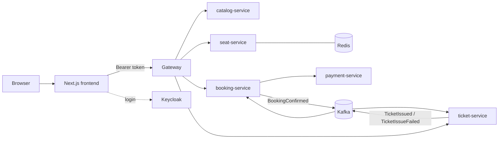

# Movie Booking

A movie ticket booking platform built as a set of small services, and built like a system that has to keep working when things go wrong: seats can't be double-booked, a retried payment can't charge twice, and a failed ticket issue refunds the booking on its own.

It started as a way to learn production practices by building them, so it covers the parts a team has to deal with after the first demo: scaling, health checks, security, CI/CD, logging, metrics and tracing.

> It runs on a local Kubernetes cluster, not a cloud account. Payments are test payments. See [Known gaps](#known-gaps).

## What you can do

- Browse movies that have upcoming shows, search them, and open a movie to see its shows by theater.
- Pick seats on a live seat map, create a booking, and pay (test payment).
- Get a QR ticket that is signed with HMAC, so it can't be forged.
- List your bookings, cancel one, and see its ticket.
- Use the admin pages (movies, theaters, screens, shows) if you have the `catalog-admin` role.

## Architecture



| Part | Port | Role |
| --- | --- | --- |
| frontend | 3001 | Next.js 16 app. Its server logs in through Keycloak and calls the gateway, so tokens never reach browser code |
| gateway-service | 8090 | Spring Cloud Gateway: JWT check, rate limiting, routing. Kong is set up beside it for comparison |
| catalog-service | 8085 | Movies, theaters, screens, shows. REST and GraphQL, cached reads |
| seat-service | 8081 | Seat holds in Redis (Lua, atomic) and seat state in Postgres |
| booking-service | 8082 | Bookings, payment orchestration, expiry, transactional outbox |
| payment-service | 8083 | Test payments |
| ticket-service | 8084 | Issues HMAC-signed QR tickets, with its own outbox |

Each service has its own Postgres database. Services talk through REST for requests and Kafka for events.

## What is in it

**Correctness**
- Seats are held in Redis with a Lua script, so two people can't hold the same seat. A version column protects the database row.
- Booking and payment calls use idempotency keys, so a retry returns the first result.
- Events go out through a transactional outbox, and consumers are idempotent (a unique constraint is the race guard).
- A choreography saga: if a ticket can't be issued, the booking is cancelled and a refund is requested. Failed messages go to a dead-letter topic.

**Security**
- Keycloak with OAuth 2.0 and PKCE. Every service validates the JWT. Roles control the admin pages, checked on the server.
- Service-to-service calls use the client credentials flow.
- Secrets live in Kubernetes Secrets built from a file that is not in git.

**Running it**
- Kubernetes with Kustomize overlays (`local` and `stage`), readiness and liveness probes, graceful shutdown, and horizontal pod autoscaling.
- GitOps with Argo CD.
- Spring Cloud Gateway and Kong compared with k6 load tests (`loadtests/`).

**CI/CD** (GitHub Actions)
- Pull requests run the tests for the services and the frontend.
- A push to `main` builds the images, scans them and pushes them to GHCR. A bot then opens a pull request that bumps the image tags in the overlays, and Argo CD deploys the merge.

**Observability**
- Metrics: Prometheus. Logs: Loki. Traces: Tempo (OpenTelemetry). All in Grafana, with Alloy collecting from the pods.
- Every log line carries a request id and a trace id, and Grafana links a log line to its trace.

**Tests**
- Services: Testcontainers with real Postgres and Kafka. Frontend: Vitest, Playwright end-to-end tests against a mock gateway, and axe accessibility checks.

## Tech stack

Java 21, Spring Boot 4.1, Spring Cloud Gateway, Spring Security, Spring Kafka, Spring Data JPA, Flyway, Postgres, Redis, Kafka (KRaft), Keycloak, GraphQL, Next.js 16, React, TypeScript, Tailwind, Auth.js, Docker, Kubernetes (kind), Kustomize, Argo CD, Kong, GitHub Actions, Prometheus, Grafana, Loki, Tempo, Alloy, OpenTelemetry, k6, Testcontainers.

## Repository layout

```
services/      the six Spring Boot services
frontend/      the Next.js app
deploy/        docker-compose, Kubernetes base and overlays, Argo CD, Keycloak realms,
               Grafana, Prometheus, Loki, Tempo and Alloy configuration, seed data
loadtests/     k6 scripts
.github/       CI and publish workflows
```

## Run it locally

Tested on a Mac with Apple Silicon, Docker Desktop and a kind cluster. The images are built for arm64.

1. **Infrastructure** (Postgres per service, Redis, Kafka, Keycloak, Grafana stack). Create `deploy/.env` with the database users and passwords, the Keycloak admin login and the secrets the services read (it is ignored by git; the variable names are in `deploy/docker-compose.yml`), then from `deploy/`:
   ```
   docker compose up -d
   ```
2. **Services.** Run them from your IDE, or in a kind cluster: `deploy/k8s/create-secrets.sh` creates the Secrets, and `deploy/argocd/application-local.yaml` is the Argo CD application that deploys the `local` overlay.
3. **Gateway.** Reach it with `kubectl port-forward svc/gateway-service 8090:8090 -n movie-booking`.
4. **Frontend.**
   ```
   cd frontend
   cp .env.example .env.local   # fill in AUTH_SECRET and AUTH_KEYCLOAK_SECRET
   npm install
   npm run dev                   # http://localhost:3001
   ```
   The `movie-booking-web` client must exist in Keycloak with the redirect URI `http://localhost:3001/*`.
5. **Sample data.** `deploy/seed/` has SQL for movies, shows and seats, and a script that fetches posters.

Tests: `./mvnw test` inside a service (Docker must be running), and `npm test`, `npm run e2e` in `frontend/`.

## Known gaps

- Payments are test payments, with no real provider.
- A show created on the admin page has no seat map yet, because nothing creates its seat rows.
- The booking total is a flat amount per seat, not the show's own price.
- It runs on one laptop cluster, local and stage share the same Postgres, Kafka and Keycloak, and the frontend image is arm64 only.

## License and credits

All rights reserved. The code can be read and run locally for learning, and any other use needs written permission. See [LICENSE](LICENSE).

Movie data and posters: this product uses the TMDB API but is not endorsed or certified by TMDB.
